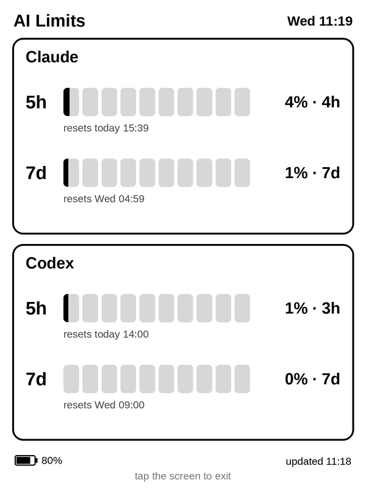
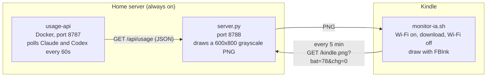

<div align="center">

# Kindle AI Usage Monitor

**An old Kindle turned into a desk display for your Claude Code and Codex usage limits.**




[How it works](#how-it-works) &nbsp;&bull;&nbsp; [Requirements](#requirements) &nbsp;&bull;&nbsp; [Setup](#setup) &nbsp;&bull;&nbsp; [Battery](#battery) &nbsp;&bull;&nbsp; [Troubleshooting](#problems-i-ran-into-and-how-i-fixed-them)

</div>

---

The e-ink screen is easy on the eyes, readable in any light, and uses almost no power to keep a static image on screen. It sits next to my monitor and tells me how much of the 5-hour and weekly limits I have left before a tool stops answering in the middle of a task.

## What it shows

Each service has two rows:

- **5h**: the short window, which resets a few hours after the first use.
- **7d**: the weekly limit.

The 10 blocks fill up with usage. Next to them are the percentage and the time left until the reset, and below them the exact day and time of the reset. From 90% on, a "LIMITE PRÓXIMO" (limit close) warning shows up. The footer shows the Kindle battery, with an estimate of the hours left, and the time of the last update.

The on-screen text is in Brazilian Portuguese. All labels live in `server.py` and are easy to translate.

The segmented bar look was inspired by the [Claude-Code-Usage-Monitor](https://github.com/CodeZeno/Claude-Code-Usage-Monitor) taskbar widget, which I already used on my desktop.

## How it works



The main decision was to do all the work on the server. The Kindle only downloads a finished image at the exact screen size and draws it. It needs no Python, browser or fonts on the device, and any visual change happens on the server without touching the Kindle.

The laptop where I started the project is often turned off, so nothing can depend on it. Everything runs on the Beelink, a mini PC that is always on.

## Requirements

**Kindle**

- A jailbroken Kindle. I used a Kindle Basic 10th generation (KT4) on firmware 5.18.1.1.1 with the SpiderCat jailbreak. Guides for each model and firmware are at [kindlemodding.org](https://kindlemodding.org).
- Scriptlet support: `.sh` files in the `documents` folder show up in the Library like books and run as root when tapped. SpiderCat ships with this.
- [FBInk](https://github.com/NiLuJe/FBInk) to draw on the screen. It comes with the jailbreak's libkh package (`/mnt/us/libkh/bin/fbink`).
- Wi-Fi on the same network as the server.

**Server**

- Any Linux machine that stays on. I used a Beelink running Ubuntu 22.04 and CasaOS.
- Docker, for `usage-api`.
- [uv](https://docs.astral.sh/uv/) to run `server.py`. It fetches Pillow by itself, with no sudo, pip or venv needed.
- The Liberation Sans fonts (`LiberationSans-Regular.ttf` and `LiberationSans-Bold.ttf`) in a `fonts/` folder next to `server.py`.

**Accounts**

- A Claude subscription (Pro or Max) logged in to Claude Code.
- A ChatGPT subscription logged in to Codex.

## What's in the repository

| Path | What it is |
|---|---|
| `usage-api/` | Node app in Docker that logs in to Claude Code and Codex and serves `/api/usage` as JSON. It also has a simple HTML page at `/kindle`. |
| `server.py` | Renderer. Reads the JSON and returns the 600x800 PNG at `/kindle.png`. It also serves the Kindle script and receives remote logs. |
| `kindle/monitor-ia.sh` | Scriptlet that runs on the Kindle. It shows up in the Library as "Monitor IA". |
| `kindle/tela-sempre-ligada.sh`, `kindle/tela-normal.sh` | Shortcuts to turn the screensaver off and back on. |
| `deploy/` | Startup script and cron entries for the server. |

## Setup

### 1. Jailbreak the Kindle

Follow the guide for your model at [kindlemodding.org](https://kindlemodding.org).

> [!WARNING]
> Before you start, back up the Kindle storage over USB. A jailbreak always carries some risk for the device.

After the jailbreak, check that any `.sh` file copied to `documents` shows up in the Library.

### 2. Usage service (`usage-api`)

On the server:

```sh
cp -r usage-api /DATA/AppData/kindle-ai-usage/app
cd /DATA/AppData/kindle-ai-usage/app
sudo docker compose up -d --build
```

`compose.yml` uses CasaOS paths (`/DATA/AppData/...`). On other systems, adjust the volume.

Log in inside the container:

```sh
sudo docker exec -it kindle-ai-usage claude auth login
sudo docker exec -it kindle-ai-usage codex login --device-auth
```

If the Codex device code login fails, run a plain `codex login`. It prints a URL to open in your browser. At the end, the browser tries to open `http://localhost:1455/auth/callback?...` and fails, because the callback was supposed to reach the container. Copy that whole URL and run `curl "COPIED_URL"` inside the container.

Test it with `curl http://localhost:8787/api/usage`. The expected format is:

```json
{
  "updatedAt": "2026-10-28T01:15:12.664Z",
  "stale": false,
  "claude": {
    "available": true,
    "status": "available",
    "fiveHour": { "usedPercent": 2, "resetsAt": "2026-10-28T06:10:00Z" },
    "weekly":   { "usedPercent": 63, "resetsAt": "2026-10-28T08:00:00Z" }
  },
  "codex": { "...": "same format" }
}
```

Any other service that returns this JSON works with the renderer. Just point `USAGE_URL` at it.

### 3. Renderer (`server.py`)

```sh
mkdir -p ~/kindle-monitor/fonts
cp server.py kindle/monitor-ia.sh deploy/run.sh ~/kindle-monitor/
cp /path/to/LiberationSans-*.ttf ~/kindle-monitor/fonts/
~/kindle-monitor/run.sh
crontab -e   # paste the contents of deploy/crontab.txt
```

To check it, open `http://SERVER-IP:8788/kindle.png` in a browser. `run.sh` expects `uv` at `~/.local/bin/uv`.

Optional variables: `PORT` (default 8788), `USAGE_URL` (default `http://127.0.0.1:8787/api/usage`), `DISPLAY_TZ` (default `America/Sao_Paulo`) and `FONT_DIR`.

To render a single test image without starting the server: `uv run --script server.py --once test.png`.

### 4. Script on the Kindle

Edit the `BASE=` line in `kindle/monitor-ia.sh` with your server's IP. Then copy the file to the Kindle's `documents` folder over USB. It shows up in the Library as **Monitor IA**.

> [!NOTE]
> You only need USB for this first copy. Every time it opens, the script downloads the version on the server (`/monitor-ia.sh`) and replaces itself if it changed. To update the Kindle, just change the file on the server.

## Usage

- **Open:** tap "Monitor IA" in the Library. The Kindle UI is stopped and the display shows up within a few seconds.
- **Exit:** tap anywhere on the screen or press the power button. The Kindle UI comes back in about a minute. Meanwhile the screen shows "Saindo do Monitor IA..." (exiting).
- **Logs:** the Kindle sends each important event to the server, which writes it to `~/kindle-monitor/server.log` with a `KINDLE` prefix. This lets you debug without a USB cable. There is also a local log at `/mnt/us/monitor-ia.log`.

## What the script does on the Kindle

1. Sets `preventScreenSaver` so the screen never locks.
2. Stops the Kindle UI (`stop lab126_gui`). Otherwise the UI redraws over the display and reacts to taps.
3. Starts a background reader for each input device (`/dev/input/event*`). The first tap or button press ends the monitor.
4. Every 5 minutes: turns Wi-Fi on, waits for the connection, downloads the PNG with the battery level (`?bat=78&chg=0`), turns Wi-Fi off and redraws only if the image changed. Every 10 updates it does a full, flashing refresh to clear e-ink ghosting.
5. If the download fails, it retries every 10 seconds and shows a warning after two failures.
6. On exit: turns Wi-Fi back on, restores the screensaver, starts the UI again, waits for the Library (`KPPMainApp`) to show up and forces two screen refreshes.

## Battery

Real measurement with the Kindle unplugged and the monitor open: from 97% to 70% in 6h15, about 4.3% per hour, or around 22 hours of continuous use.

Turning Wi-Fi off between updates barely changed this. Before that change the measurement was around 4% per hour. The drain comes mostly from keeping the CPU awake all the time, not from the radio. 

> [!TIP]
> The best setup is to keep the Kindle on its charger as a desk display.

To make it last for days on battery, the way forward would be to suspend the device between updates and wake it with the real-time clock (RTC). I haven't done that yet.

## Problems I ran into and how I fixed them

**The screen locked after a few minutes.** This was the reason for the whole project. Without a jailbreak there is no way to turn off the screensaver. With one, it takes `lipc-set-prop com.lab126.powerd preventScreenSaver 1`.

**The Kindle looked frozen while I copied files.** It was just slow USB writes. Waiting was enough.

**Fully white screen when opening the monitor.** After unplugging USB, Wi-Fi takes a while to reconnect and the first download failed. The script now retries every 10 seconds and shows "Sem conexão" (no connection) on screen.

**"The selected application could not be started" on exit.** I was trying to open the home screen with `app://com.lab126.booklet.home`, which doesn't exist on this firmware. The Library is `com.lab126.KPPMainApp`. I removed the call and now only restart the UI.

**Screen stuck on "Saindo..." even after the UI came back.** Right after the UI restarts, the Kindle still reports the scriptlet launcher as the active app, and the script took that as ready. It now waits 15 seconds, waits specifically for `KPPMainApp` (up to two and a half minutes) and does two full refreshes. 

> [!TIP]
> If the screen is still stuck, a short press on the power button (sleep and wake) forces a redraw.

**Codex login in the container failed with "error sending request for url".** The `node:22-bookworm-slim` image has no root certificates. The `Dockerfile` in this repository already installs `ca-certificates`.

**Do these logins conflict with the ones on my desktop?** No. Each machine has its own login and they get along fine. What breaks things is copying the credentials file from one machine to another: refresh tokens rotate, and one copy ends up invalidating the other.

**Server with no pip, venv or sudo.** I copied the `uv` binary to `~/.local/bin`. `server.py` declares its Pillow dependency inline (PEP 723) and `uv` takes care of the rest.

**Jagged edges on e-ink.** The PNG is drawn at twice the resolution and downscaled with LANCZOS at the end. For partly filled blocks, I use a mask shaped like the block, which keeps the rounded corners and a straight cut.

## Useful commands on the Kindle

```sh
lipc-get-prop com.lab126.powerd battLevel          # battery
lipc-get-prop com.lab126.powerd isCharging
lipc-set-prop com.lab126.cmd wirelessEnable 0      # Wi-Fi (1 turns it on)
lipc-get-prop com.lab126.wifid cmState             # CONNECTED when connected
lipc-get-prop com.lab126.appmgrd activeApp         # foreground app
stop lab126_gui ; start lab126_gui                 # Kindle UI
/mnt/us/libkh/bin/fbink -c -f -g file=img.png      # draw an image
/mnt/us/libkh/bin/fbink -s -f                      # full screen refresh
```

## Credits

- [Claude-Code-Usage-Monitor](https://github.com/CodeZeno/Claude-Code-Usage-Monitor), for the segmented bar idea.
- [FBInk](https://github.com/NiLuJe/FBInk), by NiLuJe, which draws on the Kindle screen.
- The [kindlemodding.org](https://kindlemodding.org) and MobileRead communities, for the jailbreak.

This project was built together with Claude Code, which wrote most of the code while I tested it on the device.

## License

[MIT](LICENSE)
